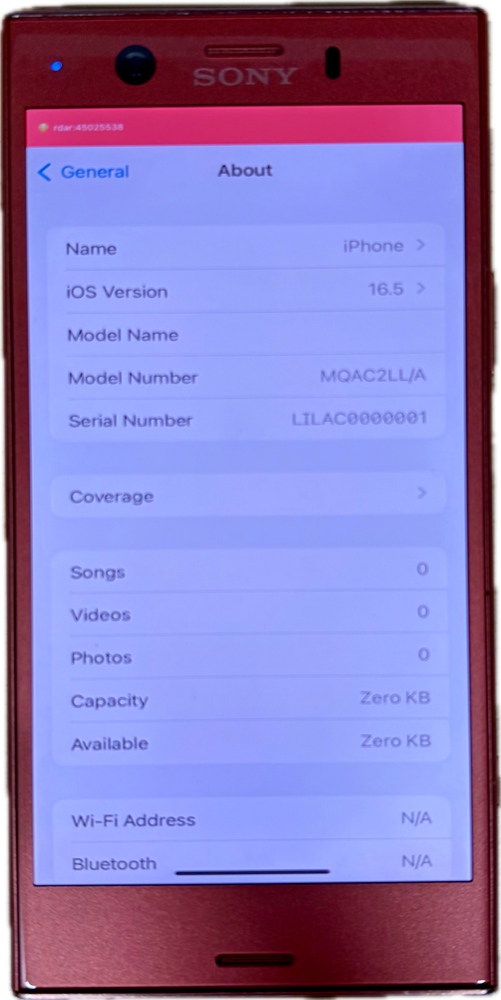

# lilac-xnu

> [!NOTE]
> 1. 本仓库为实验性项目，所有移植工作由 GPT-6 Astra 完成
> 2. 相机、GPU 等完整适配工作仍未完成，真机能够启动 iOS，但不推荐日常使用
> 3. 若为 Docomo 日版机型，需先使用 xperable 解锁 bootloader

`lilac-xnu` 是一个将 Apple XNU 内核及 Darwin 用户空间系统移植至 Sony Xperia XZ1 Compact（设备代号 `lilac`，高通 MSM8998 平台）。项目涵盖底层引导器 BootShim、只读 UFS 驱动及系统物理区间映射、Adreno 540 硬件渲染加速、Synaptics S3330 多点触摸驱动以及 Darwin 基础运行环境。

当前系统已实现由 BootShim 接管引导流程并加载 XNU 内核，挂载只读 APFS 系统卷，运行原版 Apple `launchd`，并通过 Mesa Freedreno 与 CoreAnimation 实现 GPU 桌面合成渲染。

详细支持情况与已知限制参阅[项目状态](docs/STATUS.md)。

<div align="center">
  
</div>

## 源码与环境

XNU、HakiOS、xperable 和 pe-parse 的固定源码快照直接集成在仓库目录中，检出后无需额外配置 Git 子模块或打补丁，可直接修改并提交代码。版本基线、来源仓库与对应许可证请参阅 [upstream.lock.json](upstream.lock.json) 与[第三方源码说明](docs/SOURCES.md)。

### 依赖工具

项目统一采用 `./lilac` 命令行工具管理构建，运行环境要求 Python 3.9 或更高版本。

- **主机构建环境**：Git、Clang、Make、CMake、pkg-config、OpenSSL、libusb。
- **macOS 环境**：需安装 Xcode；编译 BootShim 需安装 LLVM 工具链（Clang、LLD、llvm-objcopy、llvm-nm）。
- **Linux 环境**：需安装 flex、bison、m4、autoconf、automake，以及 cctools / Theos 工具链。
- **系统材料解包**：解包 iOS IPSW 需要支持 APFS 格式的 7-Zip 23 或更高版本。

### 本地材料配置

SDK、IPSW 固件、Sony 专有固件、设备设备树（DTB）以及物理区间映射表属于用户私有材料，不随仓库分发。可以在 `local/config.json` 中配置材料路径，参考模板位于 [configs/local.example.json](configs/local.example.json)。

```sh
./lilac sources check
./lilac doctor
./lilac deps fetch
```

- `sources check`：核验源码目录结构与符号链接完整性。
- `doctor`：检查当前主机环境的工具链与依赖完整度；可指定 `--target kernel` 等参数针对特定目标进行检查。
- `deps fetch`：下载锁定的额外开源依赖项；支持 `--offline` 参数离线校验已有缓存。

`build kernel` 会自动构建内核及工具链依赖，无需预先运行 `deps build`。如果只准备工具链、不编译内核，仍可单独执行 `./lilac deps build`。

## 构建流程

```sh
# 1. 编译 XNU 内核
./lilac build kernel

# 2. 提取并解包 iOS 运行时材料
./lilac inputs ios --ipsw /path/to/iOS-16.5.ipsw --unpack

# 3. 构建供 UFS 使用的 APFS 系统镜像
./lilac build system

# 4. 构建用户空间 RAM 启动镜像
./lilac build userspace
```

`build userspace` 默认使用最近一次成功构建的内核，也可以通过 `--kernel PATH` 显式指定；它会自动编译 BootShim 并打包启动镜像。`build system` 自行编译所需的 `hello_dyn`，无需先构建 `userspace`，也可用 `--probe-binary PATH` 指定已有程序。使用 `--output PATH` 可指定新的输出目录，构建成功后将自动刷新 `out/latest/<目标>` 软链接。

下载工具通过 `./lilac build xperable` 按需编译；Mesa 图形库的构建见下文。部署 UFS 系统镜像并生成映射表后，可使用下面的参数构建移动运行时启动镜像。

### 构建具备移动运行时的用户空间镜像

```sh
./lilac build userspace \
  --ufs-kernel-probe \
  --ufs-system-map configs/lilac/system-map.bin \
  --mobile-runtime \
  --desktop-attempt \
  --fast-boot \
  --desktop-bringup \
  --touchscreen
```

用户空间镜像构建默认启用多核心 SMP 支持。当包含 GPU 桌面配置时，系统默认开启 180/257 MHz 动态调频及空闲自动电源管理。若需进行底层排查，可通过 `--no-smp`、`--no-gpu-runtime-pm` 或 `--no-gpu-dynamic-clock` 显式关闭对应特性。更详细的构建参数与系统材料规范请参阅[用户空间文档](docs/USERLAND.md)与 [UFS 系统镜像文档](docs/UFS-SYSTEM.md)。

### 编译 Mesa 图形驱动

```sh
./lilac deps fetch --with-mesa
./lilac build mesa
```

Mesa 构建采用锁定的 25.0.7 源码与依赖版本，编译环境隔离在 `out/` 目录下。主机构建需配备 Bison 3 或更新版本、flex 及 LLVM 工具链。

### 高级诊断镜像

底层引导与硬件探测通过 `debug` 入口构建：

```sh
# 基础 RAM 引导镜像，默认运行 hello 程序
./lilac debug ramboot

# 触摸控制器探测镜像
./lilac debug hardware --touch
```

原 `build ramboot`、`build hardware` 分别改为 `debug ramboot`、`debug hardware`；产物仍发布到 `out/latest/ramboot` 和 `out/latest/hardware`。这两项用于单独排查引导或驱动，不属于日常构建步骤。可通过 `./lilac debug ramboot --help` 或 `./lilac debug hardware --help` 查看诊断参数。

## 测试与校验

项目提供完善的本地测试套件，分为主机单元测试与集成测试：

```sh
# 运行主机单元测试（无需目标设备与专有材料）
./lilac test host

# 针对特定构建运行集成验证
./lilac test integration --build out/latest/userspace
```

主机测试覆盖 UFS 命令解析、GPT 解析、BootShim 逻辑、内存对齐与输入协议；集成测试进一步核验 APFS 回读、镜像布局与固件兼容性。详见[验证规范文档](docs/VALIDATION.md)。

---

致谢所有上游项目
